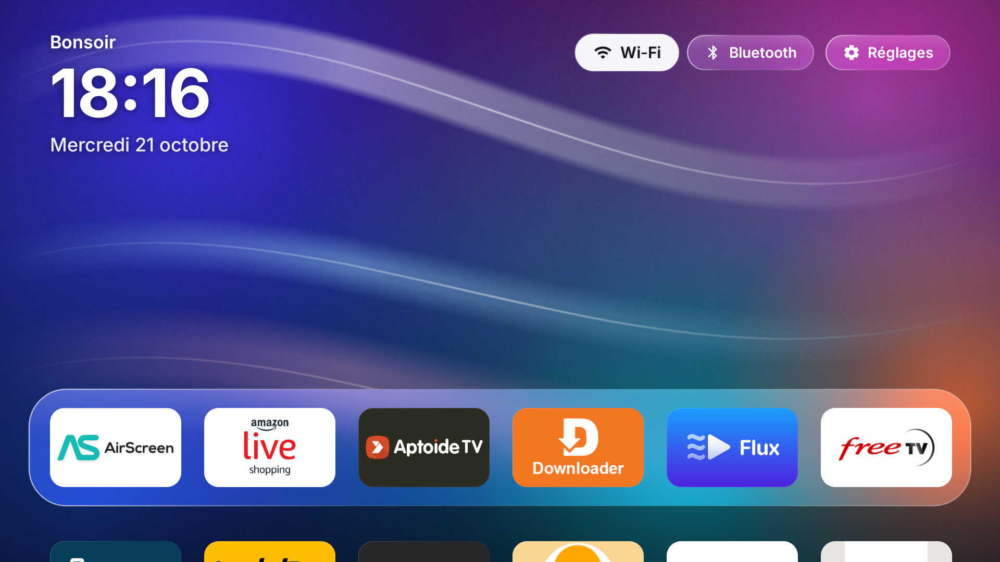
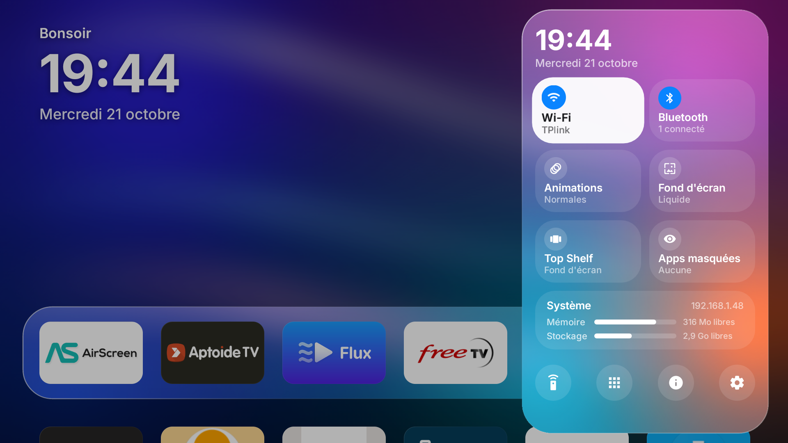

# Glass — un écran d'accueil façon tvOS pour Android TV

Glass remplace l'écran d'accueil d'une Android TV ou d'une Fire TV par une interface inspirée de tvOS,
avec des panneaux en « Liquid Glass ». Il fonctionne dès **Android 7.1**, y compris sur les anciennes
Fire TV (Fire OS 6), où les launchers récents ne s'installent pas.

<p align="center">
  
  
</p>

*English summary: a tvOS-style home screen for Android TV / Fire TV (Android 7.1+), with a glass dock,
the apps' real TV banners and a Control Center for Wi-Fi, Bluetooth and system settings.*

## Fonctionnalités

- **Accueil** : salutation, grande heure et date ; dock en verre de 6 apps ; grille de 6 colonnes en dessous.
- **Vrais logos** : la bannière Android TV de chaque app en pleine carte ; à défaut, son logo sur la couleur
  de son fond, ou logo + nom sur fond blanc comme une bannière TV.
- **Focus tvOS** : agrandissement à ressort, ombre, inclinaison 3D dans le sens du déplacement, reflet.
- **Organisation** : appui long sur OK → Déplacer (l'icône tremble), Masquer, Infos sur l'app.
- **Centre de contrôle** (touche ≡ ou boutons du haut), qui glisse depuis la droite :
  - **Wi-Fi** : état, réseau actuel et IP, réseaux voisins, connexion avec mot de passe ;
  - **Bluetooth** : appareils jumelés et leur état, recherche, jumelage, oubli (la télécommande est protégée) ;
  - vitesse des **animations**, **fond d'écran**, **Top Shelf**, apps masquées ;
  - module **Système** : mémoire, stockage, IP ;
  - raccourcis vers les écrans de réglages que la TV permet d'ouvrir.
- **Fonds d'écran** : quatre styles abstraits générés par l'app, ou votre photo.
- **Léger** : APK d'environ 1,8 Mo, flou calculé une seule fois (voir plus bas).

## Installation

1. Téléchargez l'APK depuis les [Releases](../../releases), ou compilez-le (voir plus bas).
2. Sur la TV, activez le **débogage ADB** (Options pour les développeurs).
3. Depuis un ordinateur avec `adb` :
   ```bash
   scripts/install.sh <IP de la TV> chemin/vers/Glass.apk
   ```
   Le script installe Glass et accorde les permissions facultatives (recherche Wi-Fi/Bluetooth sans
   fenêtre de permission, fond d'écran perso, vitesse des animations).
4. Faites de Glass l'écran d'accueil :
   - **Android TV** : appuyez sur Home et choisissez Glass, ou sélectionnez-le dans
     Paramètres → Applications → Applications par défaut → Application d'accueil ;
   - **Fire TV et Google TV** : le launcher d'origine est protégé. Utilisez un relais du bouton Home,
     par exemple *Launcher Manager Mini* sur Fire TV, et choisissez Glass comme launcher.

### Personnaliser
- **Prénom** dans la salutation :
  `adb shell am start -n com.fares.glass/.MainActivity --es name <prénom>`
- **Fond d'écran perso** : `adb push photo.jpg /sdcard/Glass/wallpaper.jpg`, puis Centre de contrôle → Fond d'écran.
- **Autre police** : déposez vos fichiers (…Regular, …Medium, …Semibold, …Bold en .ttf/.otf) dans
  `/sdcard/Glass/fonts/`. Par défaut, Glass utilise Inter.

## Compatibilité

| | Android 7 – 9 (Fire OS 6/7) | Android 10 – 12 | Android 13 + |
|---|---|---|---|
| Wi-Fi : liste, état | ✅ | ✅ | ✅ |
| Wi-Fi : activer, se connecter | ✅ dans Glass | écran Réseau du système | écran Réseau du système |
| Bluetooth : appareils, jumelage | ✅ | ✅ | ✅ |
| Bluetooth : activer / couper | ✅ dans Glass | ✅ dans Glass | fenêtre / réglages du système |
| Vitesse des animations | avec `WRITE_SECURE_SETTINGS` (ADB) | idem | idem |

Les raccourcis de réglages s'adaptent à chaque TV (`sys/SettingsShortcuts.kt`) : pour chaque section,
Glass essaie les écrans de Fire OS puis d'Android TV et ne montre que ceux qu'une app a le droit d'ouvrir.
Sur Fire OS, par exemple, « Affichage et sons » et « Accessibilité » sont réservés aux apps d'Amazon.

## Compiler

Prérequis : JDK 17 ou plus (celui d'Android Studio convient) et le SDK Android (API 36).

```bash
echo "sdk.dir=/chemin/vers/android-sdk" > local.properties
./gradlew assembleRelease
# APK : app/build/outputs/apk/release/app-release.apk
```

Le build release est signé avec la clé de debug, pour l'usage personnel. Pour une publication sur un store,
configurez votre propre clé de signature.

## Comment marche le « Liquid Glass » sans Android 12

Le flou en temps réel (`RenderEffect`) n'existe qu'à partir d'Android 12, et les GPU des clés TV sont
modestes. Le fond étant fixe, `gfx/Blur.kt` calcule **une seule fois** un flou gaussien (trois passes de
flou « boîte » sur une image réduite à 480 px, couleurs saturées). Chaque panneau de verre (`ui/Glass.kt`)
dessine la portion exacte de ce fond flouté qui se trouve sous lui, puis une teinte, un reflet spéculaire,
une lueur intérieure et un liseré lumineux. Le coût par image se résume à un `drawImage`.

## Structure

| Fichier | Rôle |
|---|---|
| `MainActivity.kt` | Activité d'accueil, lancement des apps, permissions |
| `data/AppRepository.kt` | Apps installées, ordre, apps masquées, réglages |
| `gfx/TileFactory.kt` | Tuiles : bannière TV › logo sur fond uni › logo + nom |
| `gfx/Blur.kt`, `gfx/Wallpapers.kt` | Flou gaussien, fonds d'écran générés |
| `sys/WifiController.kt`, `sys/BluetoothController.kt` | Wi-Fi et Bluetooth du Centre de contrôle |
| `sys/SettingsShortcuts.kt`, `sys/SystemInfo.kt` | Raccourcis de réglages selon la TV, infos système |
| `ui/HomeScreen.kt`, `ui/AppTile.kt`, `ui/ControlCenter.kt`, `ui/Glass.kt`, `ui/Overlays.kt` | Interface |

## Avertissement

Glass n'est ni affilié à Apple, Amazon ou Google, ni approuvé par eux. tvOS, Fire TV et Android TV sont
des marques de leurs propriétaires respectifs. Glass n'embarque aucune ressource d'Apple : les fonds sont
générés par l'app, et les logos affichés sont ceux que chaque app installée fournit elle-même.

## Licence

Code sous licence [MIT](LICENSE).

## Licences des polices

- Inter © The Inter Project Authors — SIL Open Font License 1.1 (`app/src/main/assets/fonts/OFL-Inter.txt`)
- Google Sans Flex © The Google Sans Flex Project Authors — SIL Open Font License 1.1
  (`app/src/main/assets/fonts/OFL-GoogleSansFlex.txt`)
